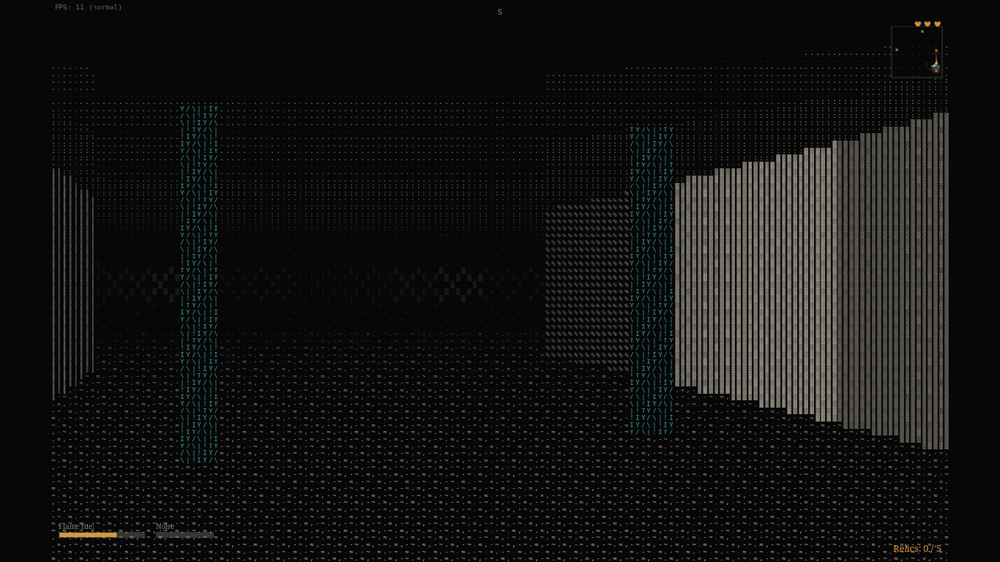
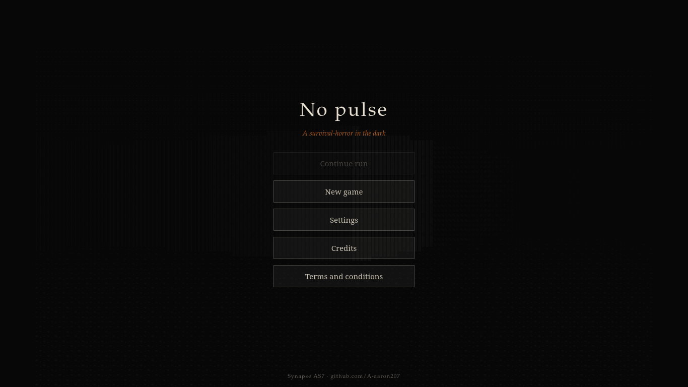
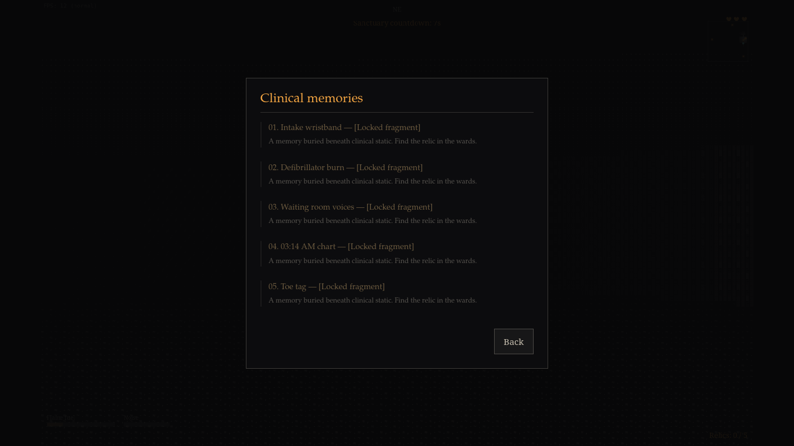
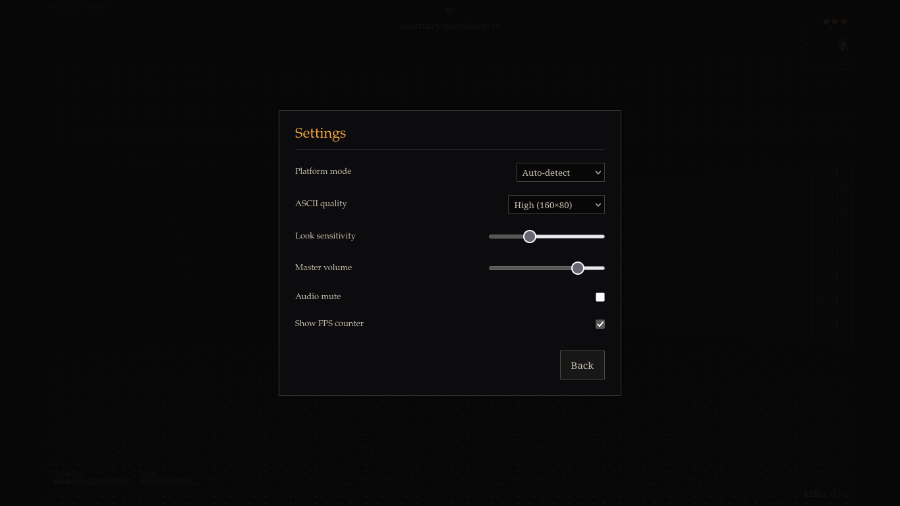
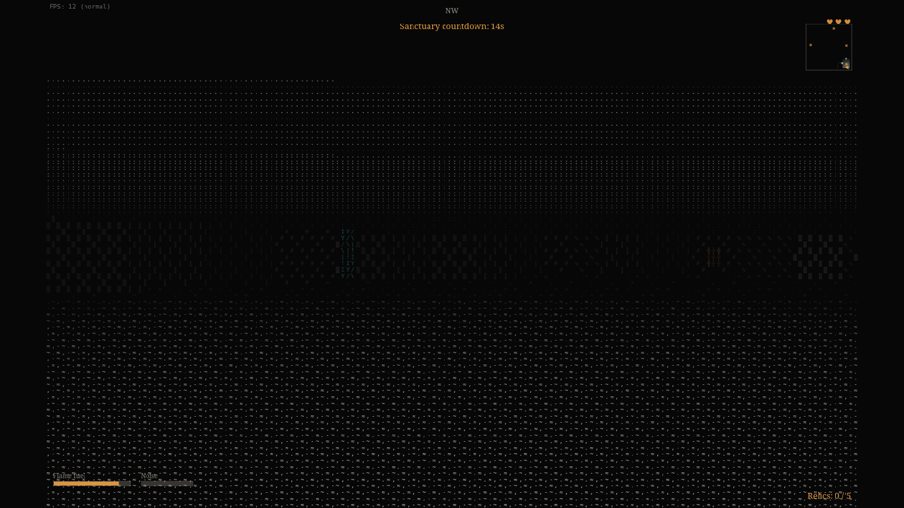

# NO PULSE

> *You are a flickering flame in a pitch-black hospital ward. A noise-driven swarm of shades hunts you from every corridor. You have no weapons—only movement, doors, stealth, and your light.*

---

[](#)
[](#)
[](#)
[](#)
[](#)

---

## Screenshots

<div align="center">
  
  
</div>

<div align="center" style="margin-top: 10px;">
  
  
  
</div>

---

## Overview

**NO PULSE** is a first-person ASCII raycaster survival-horror game built entirely within a single, self-contained `index.html` file. It requires **zero external assets, zero CDN fonts, and zero audio files**. Everything—from the 3D raycasting engine and procedural 72×72 hospital generator to the noise-driven swarm AI and multi-voice audio synthesizer—runs completely client-side in vanilla HTML5, Canvas 2D, and the Web Audio API.

---

## Narrative Premise & Twist

You awaken as a fragile, flickering flame navigating a vast, labyrinthine hospital corridor submerged in darkness. Unseen entities—the *Shades*—roam the hallways, reacting violently to sound and sudden movement. 

Your objective is to locate **5 Clinical Relics** scattered across the hospital wings, unlock the Morgue Exit, and escape.

### The Twist: *Already Dead*
The relics you collect are not keys—they are fragmented memories from resuscitation:
1. `01. Intake wristband` — *Admitted 02:41. Cyanotic. No detectable pulse.*
2. `02. Defibrillator burn` — *Two hundred joules. Clear. Smoldering conductant gel.*
3. `03. Waiting room voices` — *Muffled sobbing through corridor glass.*
4. `04. 03:14 AM chart` — *Epinephrine 1mg IV push. CPR ongoing for 34 minutes.*
5. `05. Toe tag` — *Time of pronouncement: 03:17 AM. Destination: Morgue B.*

Reaching the exit unlocks the horrifying reality: the heavy steel doors open onto an operating table bathed in the blinding glare of surgical lamps. The swarm was never monsters—it was your dying synapses fighting cardiac arrest. You never survived the night.

---

## Core Gameplay Mechanics

### 1. Light, Fuel & Cupping
- **Light = Health & Shield:** Your flame continuously burns fuel over time. If your fuel reaches zero, your light goes out and darkness consumes you.
- **Fuel Canisters:** Scattered canisters (`◈`) restore 25% of your flame.
- **Cup Flame (`Space` / Touch Button):**
  - Halves the light drain rate.
  - Compresses your light radius to a tight pinprick.
  - Silences your noise profile—crucial for slipping past shades, but dangerous if one is already stalking close.

### 2. Three-Speed Movement
| Speed | Input (Desktop) | Input (Touch) | Velocity | Noise Level | Light Drain |
| :--- | :--- | :--- | :--- | :--- | :--- |
| **Crouch** | `Ctrl` / `C` | Crouch toggle | Slow (1.5) | Silent (0.04) | 0.5× Base |
| **Walk** | `W/A/S/D` | Joystick moderate | Medium (3.0) | Moderate (0.28) | 1.0× Base |
| **Sprint** | `Shift` | Sprint toggle | Fast (5.5) | Heavy Thuds (0.85) | 2.9× Base |

### 3. Noise-Driven Swarm AI & Freeze-in-Light
- **Freeze-in-Light:** Any shade caught inside your forward light cone freezes dead in its tracks. Looking away or cupping your flame lets them swarm again immediately.
- **Dynamic BFS Flow-Field:** Shades navigate the 72×72 grid via BFS distance fields, pathfinding directly to sound spikes (sprinting footsteps, door slams, sanctuary breaches).
- **Escalation:** Each relic collected spawns additional shades and permanently increases swarm aggression.

### 4. Interactive Doors: Slam & Bolt
- **Tap `E` / Interact:** Opens the door or **slams** it shut. Slamming creates a loud noise spike (`1.0`) that alerts nearby shades across 20+ tiles.
- **Hold `E` (1.2s):** Bolts the closed door shut with a reinforced lock.
- **Door Bashing:** Closed doors force shades to bash through:
  - Standard closed door: **3.5 seconds** of banging thuds before splintering open.
  - Bolted door: **11.0 seconds** of heavy impact before breaking.

### 5. Sanctuary Save Rooms (25-Second Limit)
- Stepping into a Save Room (`+`) saves a checkpoint and triggers a calming chime.
- A **25-second countdown timer** begins immediately. While active, the sanctuary boundary repels the swarm.
- When the timer reaches zero, the sanctuary is **breached**, alarm tones sound, and the swarm floods in. Camping is impossible.

### 6. Lives & Permadeath
- You begin each run with **3 Lives** (modified by difficulty).
- If your flame extinguishes or a shade reaches you, you lose a life and respawn at your last visited sanctuary with 65% light restored, pushing nearby shades back.
- If all lives expire, your saved run is **erased** via `StorageAdapter.remove()` and the death screen appears.

### 7. Difficulty Levels
- **Easy:** 0.65× light drain, 0.8× shade speed, 35s sanctuary timer, 4 lives, +2.5 light radius.
- **Normal:** Standard survival-horror balancing, 25s sanctuary timer, 3 lives.
- **Nightmare:** 1.4× light drain, 1.25× shade speed, 15s sanctuary timer, 2 lives, tighter light radius.

---

## Visuals & Rendering Engine

### Strict 4-Color Palette (Anti-Slop Directive)
No neon glow, no cyberpunk cyan/magenta, no Matrix green, and no generic CRT overlays:

| Role | Color Name | Hex Code | Visual Application |
| :--- | :--- | :--- | :--- |
| **Void / Darkness** | Soot Black | `#070708` | Pitch-black void, deep shadows, background |
| **Architecture / UI** | Tallow Bone | `#c8c0b0` | Hospital walls, doors, serif typography, HUD borders |
| **Player Light / Relics** | Flame Amber | `#b8611c` – `#f5a642` | Radial light cone, flickering flame, relics, fuel |
| **Danger (Exclusive)** | Drowned Teal | `#1f5e5c` – `#7ad4ce` | **Shades only.** Imposing silhouettes and faint glints |

### First-Person ASCII Raycasting Engine
- **Pre-Rendered Glyph Atlas:** Glyphs across all 3 color channels and 10 discrete brightness steps are pre-rendered onto an offscreen canvas at startup. Each frame is drawn via high-speed `drawImage()` tile stamping (no per-cell `ctx.fillText()` calls), easily maintaining 60 FPS.
- **Bayer 4×4 Ordered Dithering:** Applied to the distance brightness calculation to prevent harsh concentric light-banding rings.
- **Material Glyphs:**
  - Walls & Columns: `# % ▓ ▒ ║ │`
  - Doors & Entrances: `╬ ╫ ≡ ╪`
  - Floors & Water: `~ ≈ - . ,`
  - Shades (Tall silhouette): `/ \ | ! I Y`
  - Relics & Fuel: `✦ ◈ * +`
- **Quality Presets:**
  - **Low:** 80 × 40 cells
  - **Medium:** 120 × 60 cells
  - **High (Default):** 160 × 80 cells
  - **Ultra:** 200 × 100 cells

---

## Procedural Web Audio API Synthesizer

The entire soundscape is generated algorithmically in code:
- **Ambient Drone:** Detuned low-frequency sine/triangle oscillators (46 Hz & 49.5 Hz) passing through a 160 Hz low-pass filter to generate eerie binaural beating.
- **Shade Whisper:** Bandpass-filtered pink noise buffer (540 Hz, Q=5.0) with gain tied to the proximity of the closest shade.
- **Footsteps:** Frequency-swept triangular pulses and clicks matching crouch (silent), walk, and sprint rhythms.
- **Heartbeat:** Synthesized double-thud (65 Hz & 50 Hz sine pulses) that accelerates under low fuel or high noise.
- **Doors:** Resonant low-frequency impact thuds for slams, bandpass FM sweeps for squeaks, and metallic snaps for bolts.
- **Chimes:** Resonant bell chords for relic discoveries (G-B-D-G) and soothing major triads for save rooms.
- **Flatline:** Continuous, clinical 1000 Hz sine oscillator triggered upon death and during the twist ending.

---

## Controls

### Desktop
- **Look:** Mouse (Click canvas to capture Pointer Lock)
- **Move:** `W` / `A` / `S` / `D`
- **Sprint:** Hold `Shift`
- **Crouch:** Hold `Ctrl` or `C`
- **Cup Flame:** Hold `Space`
- **Interact / Slam:** Tap `E`
- **Bolt Door:** Hold `E` (1.2s on closed door)
- **Pause / Journal:** `Esc`

### Mobile & Touch
- **Move:** Floating virtual joystick (bottom-left quadrant)
- **Look:** Swipe anywhere on the right side of the screen
- **Sprint:** `Sprint` toggle button
- **Crouch:** `Crouch` toggle button
- **Cup Flame:** Hold `Cup` button
- **Interact / Bolt:** `Open` / `Slam` / Hold for bolt
- **Pause:** `❚❚` button (top-right)

---

## Packaging & Deployment

Because **NO PULSE** is a single file with no external dependencies, packaging into native standalone executables or mobile apps is straightforward:

### 1. Web Deployment
Deploy directly to GitHub Pages, Netlify, Vercel, or any static file host:
```bash
# Simply place index.html in the root of your web server
```

### 2. Android APK (Capacitor)
```bash
npm install @capacitor/core @capacitor/cli @capacitor/android
npx cap init "No Pulse" com.synapse.nopulse --web-dir .
npx cap add android
npx cap copy
npx cap open android
```

### 3. Desktop Executable (Windows / Linux via Electron)
```bash
npm install electron --save-dev
npx electron .
```

---

## Author & Credits

- **Creator & Developer:** Synapse AS7
- **GitHub Repository:** [github.com/A-aaron207/NO-PULSE](https://github.com/A-aaron207/NO-PULSE)
- **Engine Architecture:** 100% Procedural DDA Raycaster with Bayer Ordered Dithering and Pre-rendered Glyph Atlas.
- **Audio Architecture:** 100% Procedural Web Audio API Synthesizer. Zero external audio samples.
